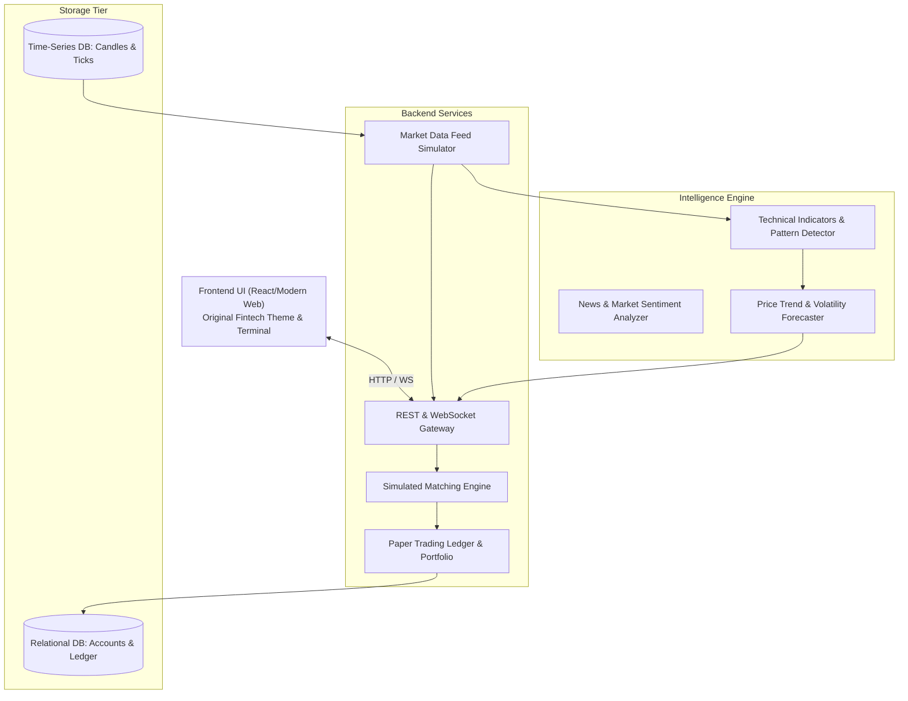
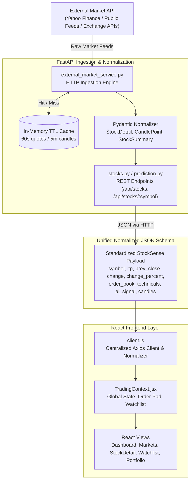

# System Architecture & Design

## 1. High-Level Architecture

StockSense-AI is organized as a modular, decoupled full-stack platform consisting of five primary tiers:

## 2. Core Modules Interaction
- **Frontend**: Connects via HTTP REST for authentication, account balances, historical candles, and order submissions. Establishes a persistent WebSocket connection for real-time simulated price ticks, order status updates, and live P&L streaming.
- **Backend**: Validates order margins against the virtual ledger, executes fills against current simulated market prices, and records double-entry bookkeeping transactions.
- **ML Engine**: Ingests incoming ticks and news digests, generating real-time sentiment scores and technical analysis overlays sent downstream to the client.
- **Database**: Stores transactional data (users, virtual portfolios, orders, trades) and time-series historical candle data.

## 3. End-to-End Market Data Pipeline

### Pipeline Steps:
1. **External Market API Ingestion**:  
   Ingests live quotes, day highs/lows, trading volume, and OHLCV historical candle vectors for Indian equities (e.g., `RELIANCE.NS`, `TCS.NS`, `INFY.NS`).
2. **FastAPI Caching & Normalization Tier**:  
   Raw multi-format external payloads are cached in-memory with configurable TTL to avoid rate-limiting. The normalizer enforces strict Pydantic models (`StockDetail`, `StockSummary`, `CandlePoint`).
3. **Normalized JSON Output**:  
   Guarantees a clean, standardized contract across all endpoints (`/api/stocks`, `/api/stocks/{symbol}`, `/api/stocks/{symbol}/history`), decoupling frontend presentation from volatile external API schemas.
4. **React Client Consumption**:  
   Centralized Axios client (`client.js`) and `TradingContext.jsx` consume the normalized JSON to power interactive candlestick charts, watchlists, market depth, and paper trading execution.

